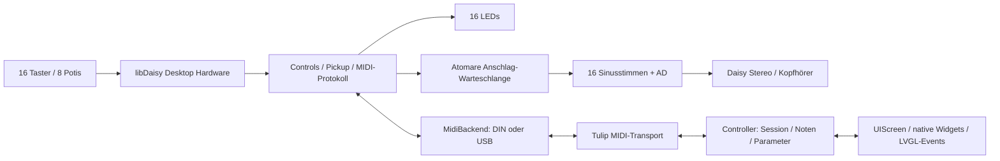

# Architektur

## Verantwortlichkeiten

- `config/protocol.json`: einzige editierbare Quelle für Notenbelegung, CCs,
  MIDI-Kanal, Parametergrenzen und Sessionzeiten. Generator und CI prüfen beide
  abgeleiteten Dateien. Keine versteckte alternative Tastenbelegung.
- `daisy/include/control.h`: physische Tasten-IDs, MIDI-Referenzzähler je Note,
  LED-Ableitung, logarithmische Parameterabbildung und Pickup.
- `midi_control.h`: anwendungsbezogenes MIDI-Routing, unabhängig vom Transport.
  Verwendet dieselben libDaisy-Events wie die Firmware und die Hosttests.
- `midi_backend.h`: nur der ausgewählte DIN- oder USB-Transport. Genau ein
  Eingang aktiv; kein automatisches MIDI-Thru oder Doppelrouting.
- `strike_queue.h`: SPSC-Ring mit 63 nutzbaren Einträgen, atomare Publish-/Consume-
  Indizes mit Acquire/Release. Nur Hauptschleife schreibt, nur Audio liest.
- `synth.h`: 16 DaisySP-Oszillatoren und je eine eigene testbare AD-Hüllkurve.
  Gleiche Tonhöhen werden kontinuierlich retriggert. Keine Reset-Phasensprünge,
  keine harte Verdrängung laufender anderer Stimmen. Parameter werden beim
  Anschlag übernommen; Änderungen biegen einen laufenden Ausklang nicht abrupt um.
- `daisy/src/main.cpp`: Hardwareintegration und Zeitplanung.
- Tulip `transport.py`: native `midi.add_callback/remove_callback` und
  `tulip.midi_out`, ohne Widgets oder eigene Audioverarbeitung.
- Tulip `controller.py`: testbare Session-/Notenverwaltung, Parameter-Drosselung
  und Zustandsabgleich. Kein Import von Tulip, LVGL oder AMY.
- Tulip `app.py`: Layout und Event-Zuordnung. Nutzt fertige `UIButton`,
  `UISlider`, `UILabel` und `UIScreen`. Nur notwendige Press-/Release-Events
  werden direkt auf den zugrunde liegenden LVGL-Objekten ergänzt.

## Echtzeit und Bedienung

Audio arbeitet bei 48 kHz mit 48 Samples pro Block, also 1 ms Blockdauer. Pro
Block werden höchstens 32 Anschläge übernommen. Der Callback verarbeitet nur
Oszillatoren und Hüllkurven; er wartet auf keinen Transport und schreibt keine LEDs.
Mischpegel `0.7 / 16` begrenzt selbst 16 gleichzeitig maximal ausgesteuerte
Sinusquellen auf einen absoluten Pegel von 0,7.

libDaisy initialisiert Audio-DMA und USB standardmäßig mit Interruptpriorität 0.
Die USB-Backends setzen ihre OTG-Interrupts nach der Initialisierung auf Priorität
1, damit Audio-DMA Vorrang hat. Der Decay benutzt einen Samplezähler und erreicht
exakt null; es gibt keinen aufsummierten Float-Drift über lange Ausklänge.

Die Hauptschleife prüft die Bedienelemente ungefähr alle 1 ms. Die libDaisy-
DigitalControl-Entprellung arbeitet über mehrere Abtastungen; tatsächliche
Tastendrucklatenz ist deshalb größer als nur ein Audio-Block. UART-Tx für ein
3-Byte-Paket kann den Vordergrund etwa 0,96 ms beanspruchen. Er läuft außerhalb
des Audiocallbacks. LEDs werden alle 10 ms über die vorhandene PCA9685-/DMA-
Abstraktion aktualisiert. Rx-Arbeit ist auf 32 Ereignisse je Durchlauf begrenzt.

Bei voller Anschlag-Warteschlange wird der Anschlag verworfen und
`queue_overflows` erhöht. LED-/Notenzählung bleibt konsistent; kein endloser
Ton entsteht, weil AD immer endlich ist. `Synth::Dropped()` zählt verworfene
zusätzliche Tonhöhen bei voller Polyphonie. Beide Werte sind im ELF debuggbar.

Die Tulip-App benutzt einen LVGL-Timer mit 20 ms Periode. Keine Endlosschleife
oder Warteoperation im Python-GUI-Code. Jede Slider-CC wird höchstens alle
40 ms gesendet, Zwischenwerte werden zusammengefasst. Die unveränderte Tulip-
Firmware kann bei USB-MIDI intern blockieren; diese externe Einschränkung bleibt
beim USB-Backend bestehen und ist der Grund für die DIN-Empfehlung.

## Haltezustände und Hüllkurven

Jeder physische Taster hat ein eigenes boolesches Besitzrecht. MIDI hat einen
saturierenden 8-Bit-Zähler pro Tonhöhe. Das Loslassen einer Quelle löscht keine
andere. MIDI-Note-On mit Velocity 0 entspricht Note-Off. Ein Note-Off ohne
vorheriges Note-On wird ignoriert. GUI-Tasten haben getrennte IDs, einschließlich
der beiden C5. Doppelte Press-Callbacks derselben GUI-/Hardwaretaste retriggern
nicht.

Jeder neue berechtigte Anschlag kann die zugehörige Tonhöhe retriggern. Die
AD-Hüllkurve steigt linear vom aktuellen Pegel auf 1 und fällt linear auf 0.
Es gibt kein Sustain und kein verkürzendes Note-Off-Release. LEDs bedeuten
**gehaltene Taste**, nicht „Audio ist gerade hörbar“. Eine lange gehaltene
Taste kann leuchten, obwohl ihr Klang bereits ausgeklungen ist; nach Loslassen
kann der Ausklang bei erloschener LED noch hörbar sein.

## Lebenszyklus

`UIScreen` hält die App am Leben. `activate` fordert erneut einen Zustand an;
`deactivate` sendet alle aktiven Note-Offs und CC123 und sperrt Anschläge im
Hintergrund. `quit_callback` beendet den Controller, entfernt den eigenen MIDI-
Callback und löscht den LVGL-Timer. Anschließend entfernt UIScreen den Widget-
Baum einschließlich Event-Callbacks. Cleanup wird schon vor dem Widgetaufbau
registriert, damit auch ein abgebrochener App-Start aufräumen kann.

Nur der eigene MIDI-Callback wird registriert/entfernt. Andere Tulip-Apps und
ihre Callbacks werden nicht pauschal zurückgesetzt. Es wird kein Tulip-Synth
gestartet; von Daisy werden keine Spielnoten an Tulip zurückgespiegelt.

## Spätere modulare Synthesizer

Die Trennung bietet Platz für zusätzliche Parameterdeskriptoren, Synthmodule,
andere DSP-Klassen und Transportadapter. MIDI-CCs sind für wenige Parameter
gut geeignet. 7-Bit-Quantisierung, fehlende Geräteidentität und fehlendes
Transaktionsformat sind die Grenzen des Alpha-Protokolls. Später wären
Parameter-IDs mit Metadaten, 14-Bit-Werte/NRPN und ein versionierter SysEx-
Zustandsaustausch sinnvoll. Das ist keine Voraussetzung für diesen Prototyp.
Mehrfinger-GUI, Presets, komplexe Modulation und Sampleverwaltung sind nicht
implementiert.
